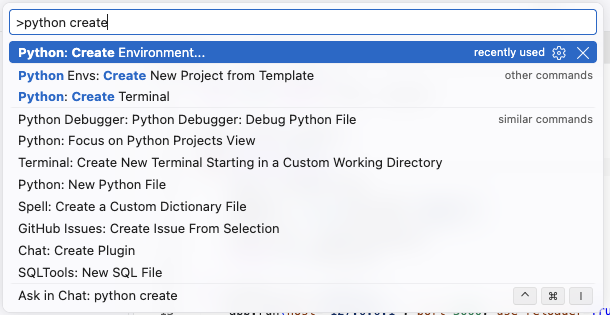
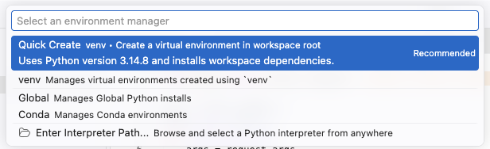
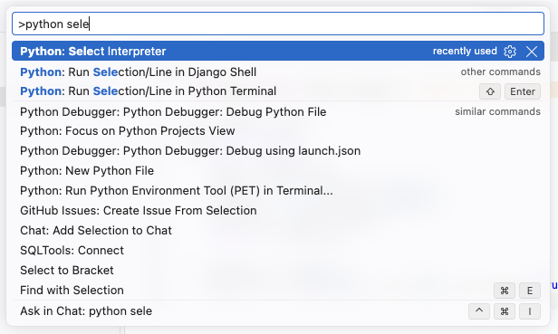
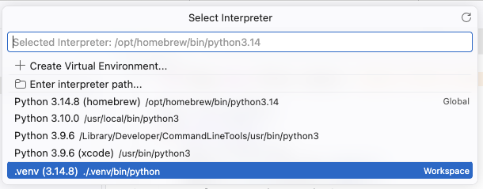

# Setting up a Python virtual environment in VS Code

This guide will help you set up a Python virtual environment in VS Code.

To create python virtual environment in VS Code, you can follow these steps:

Keyboard shortcut to open the command palette is `Ctrl+Shift+P` (Windows/Linux) or `Cmd+Shift+P` (Mac). In the command palette, type "Python: Create Environment" and select it.

Next, select `Quick Create` to create a new virtual environment in the current workspace.

Once environment is created, you can select it as the interpreter for your workspace. You can do this by opening the command palette again and typing "Python: Select Interpreter" and selecting it. Then, choose the newly created virtual environment from the list.

Select the newly created virtual environment from the list, it is the one with the name `.venv`.

Once the virtual environment is selected, you can start installing packages and running your Python code within that environment. You can install packages using the terminal in VS Code by running `pip install <package-name>`.
